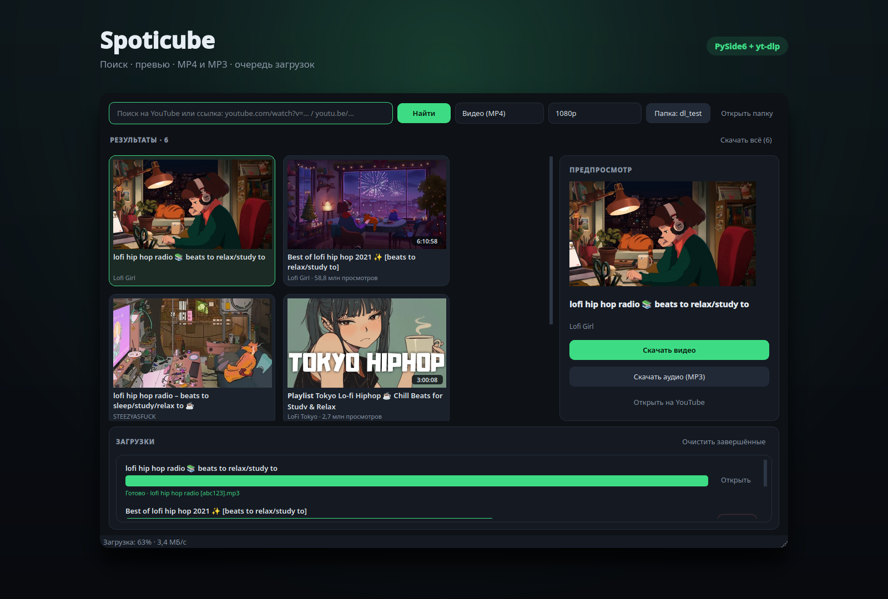

# Spoticube

<p align="center">
  
</p>

<p align="center">
  Графический загрузчик видео и аудио с YouTube на PySide6.<br>
  Поиск, превью карточками, очередь загрузок с прогрессом и отменой.
</p>

<p align="center">
  
  
  
  
  <a href="https://github.com/barsuk228332/spoticube/actions/workflows/ci.yml">
    
  </a>
</p>



## Возможности

- **Поиск по YouTube** без API-ключей (через `yt-dlp`), сетка карточек с превью.
- **Вставка ссылки**: `youtube.com/watch?v=…`, `youtu.be/…`, плейлист или канал — покажет список.
- **Превью**: миниатюры в карточках и крупная панель предпросмотра справа
  (название, канал, длительность, просмотры).
- **Скачивание**:
  - видео — MP4 с выбором качества (лучшее / 1080p / 720p / 480p / 360p);
  - аудио — MP3 с выбором битрейта (128 / 192 / 320 kbps).
- **Очередь загрузок**: прогресс, скорость, ETA, отмена, кнопка «Открыть» папку.
- **Скачать всё / плейлист целиком** — одна кнопка ставит в очередь все найденные видео
  (для плейлиста — до 100 штук).
- **Drag & drop**: брось ссылку в окно — сразу начнётся разбор.
- **Скелетоны превью**: пока картинка грузится, по миниатюре бежит мягкая волна.
- **Плавный ховер** карточек с анимированной тенью.
- **Счётчик в заголовке окна**: сколько загрузок идёт и средний процент.
- Настройки (папка, режим, качество) запоминаются между запусками.
- Тёмная тема, адаптивная сетка.

## Требования

- **Python 3.11+**
- **PySide6** и **yt-dlp** — ставятся из `requirements.txt`
- **ffmpeg** — желательно: без него нет MP3-конвертации и склейки видео+аудио
  (тогда скачивается готовый файл: `.m4a` или однопоточный `.mp4`)

## Установка

```bash
git clone https://github.com/barsuk228332/spoticube.git
cd spoticube
python3 -m pip install --user -r requirements.txt
```

Отдельно поставьте `ffmpeg`:

```bash
sudo apt install ffmpeg      # Debian/Ubuntu
sudo dnf install ffmpeg      # Fedora
```

## Запуск

```bash
python3 main.py
```

Папка загрузок по умолчанию — `~/Загрузки/Spoticube`, а если в системе нет каталога
«Загрузки» — `~/Downloads/Spoticube`. Создаётся автоматически, меняется кнопкой «Папка…».

## Тесты

```bash
python3 -m pip install --user -r requirements-dev.txt
python3 -m pytest
```

Тесты не ходят в сеть и не требуют дисплея: проверяются форматирование,
разбор ответов `yt-dlp`, выбор форматов и запись кэша превью.

## Сборка RPM-пакета

```bash
./packaging/build-rpm.sh
sudo dnf install /tmp/opencode/rpmbuild/RPMS/noarch/spoticube-*.rpm
```

Скрипт собирает пакет из текущего рабочего дерева в `/tmp/opencode/rpmbuild`
и не трогает системные каталоги. Что попадает внутрь:

- `/usr/bin/spoticube` — команда запуска;
- код в `site-packages`, иконки всех размеров в `hicolor` и `spoticube.desktop`;
- PNG/SVG в `/usr/share/spoticube/assets` — оттуда их берёт само приложение.

Зависимости: `python3-pyside6` (есть в репозиториях Fedora) и `hicolor-icon-theme`.
`yt-dlp` подключён как `Suggests` — dnf его не устанавливает, чтобы не появлялся
второй экземпляр рядом с pip-ным. Ставьте свежий через pip:

```bash
python3 -m pip install --user -U yt-dlp
```

`ffmpeg` подключён как `Recommends`. Удалять пакет лучше так, чтобы dnf не снёс
заодно Qt:

```bash
sudo dnf remove spoticube --no-autoremove
```

Пакет привязан к версии Python машины сборки. Для выкладки в Fedora его надо
перевести на `%pyproject_wheel` (пакеты `python3-devel` и `pyproject-rpm-macros`).

## Значок

Значок нарисован кодом: `assets/spoticube.svg` → PNG всех размеров + `.ico`.

```bash
python3 tools/make_icon.py   # assets/icons/*.png, spoticube.png, spoticube.ico
```

## Структура

```
main.py                       точка входа (тонкая обёртка)
spoticube/app.py              запуск приложения: окно, тема, значок
spoticube/config.py           пути, кэш превью, User-Agent
spoticube/models.py           VideoItem, SearchResult
spoticube/yt.py               поиск и опции yt-dlp (форматы, кодеки)
spoticube/workers.py          фоновые задачи: поиск, превью, загрузка
spoticube/util.py             форматирование длительности/размера/скорости
spoticube/ui/theme.py         тёмная тема (QSS)
spoticube/ui/cards.py         карточка результата, предпросмотр, строка загрузки
spoticube/ui/main_window.py   главное окно и логика
tools/make_icon.py            генерация значков из SVG
tools/render_preview.py       рендер промо-превью в docs/
tests/                        тесты (pytest, без сети и без дисплея)
packaging/                    spec-файл, .desktop и скрипт сборки RPM
assets/                       значок: SVG, PNG, ICO, набор размеров
docs/                         готовое превью интерфейса для README
```

## Как это работает

- Поиск идёт через `ytsearchN:` в «плоском» режиме — быстро, без загрузки форматов.
- Загрузка выполняется в `QThreadPool`, прогресс приходит из `progress_hooks` yt-dlp.
- Отмена выставляет флаг: хук поднимает исключение, после чего удаляются
  недокачанные `.part`-файлы.
- Превью кэшируются в `~/.cache/spoticube/thumbs/`.

## Ограничения

- YouTube периодически меняет подписи и защиты — если что-то перестало качаться,
  обновите `yt-dlp`: `python3 -m pip install --user -U yt-dlp`.
- Живые трансляции и очень длинные видео качаются долго, превью может отсутствовать.
- CI прогоняет тесты, проверку синтаксиса и сборку интерфейса в offscreen-режиме.

## Дисклеймер

Проект учебный. Скачивайте только тот контент, на который у вас есть право,
и соблюдайте [условия использования YouTube](https://www.youtube.com/t/terms).

## Лицензия

[MIT](LICENSE)
